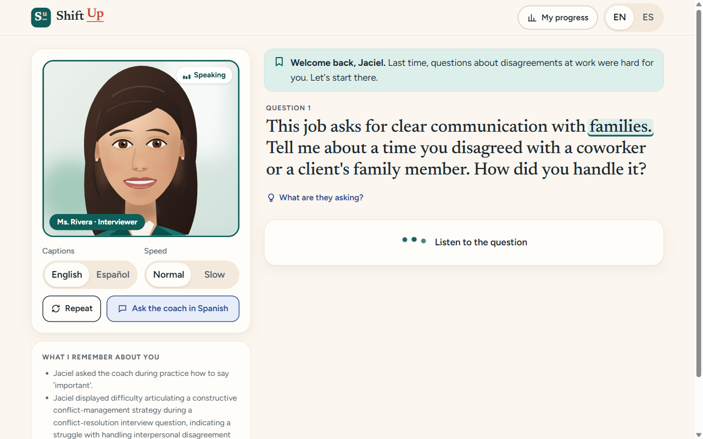
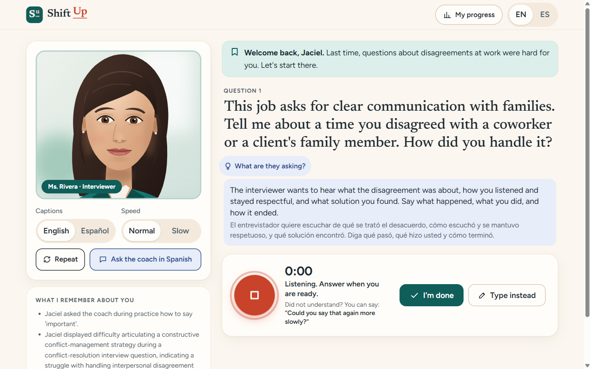
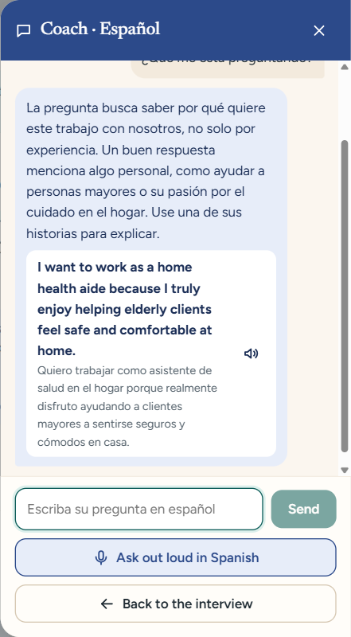
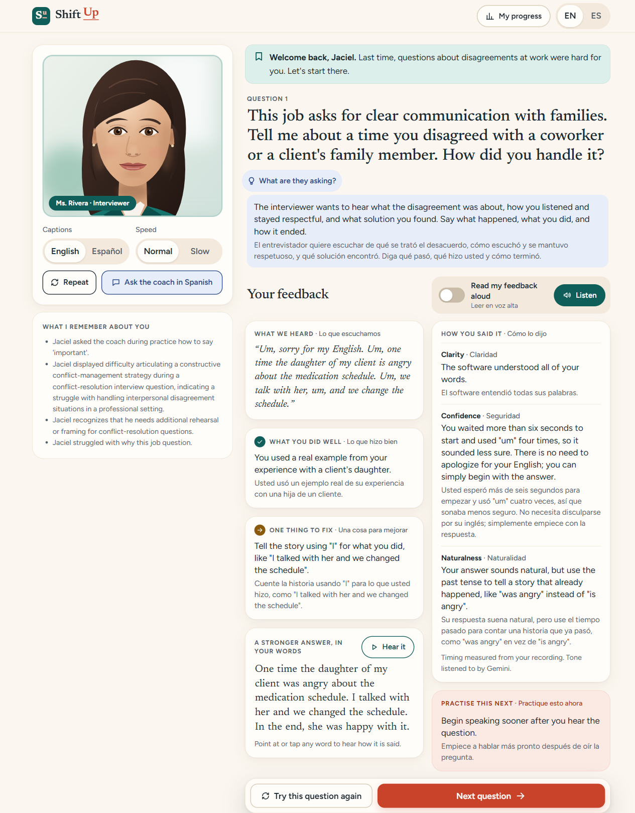
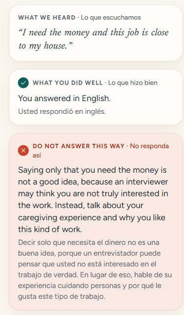
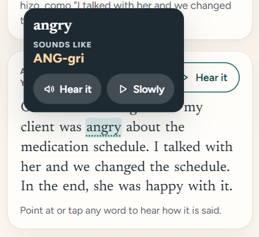
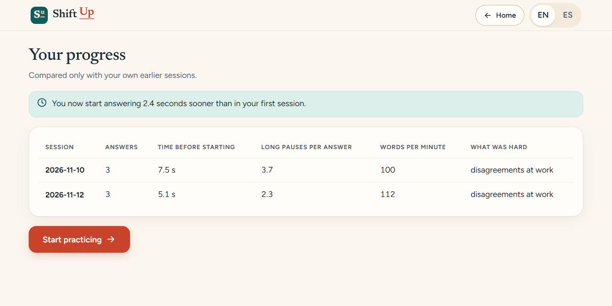
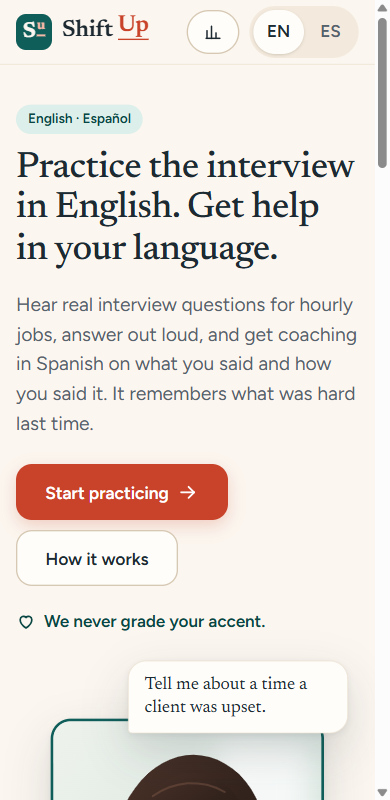
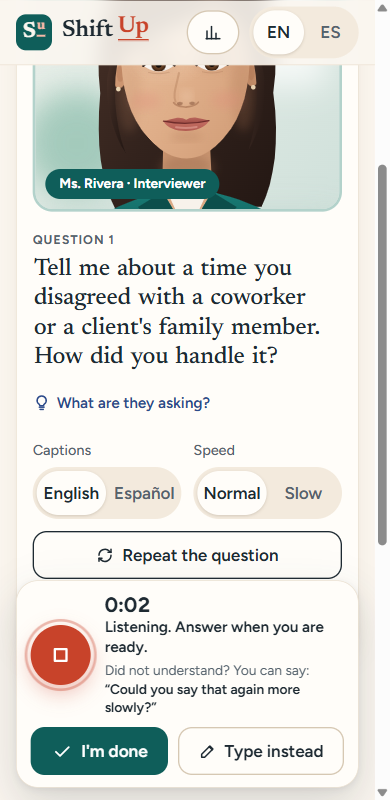
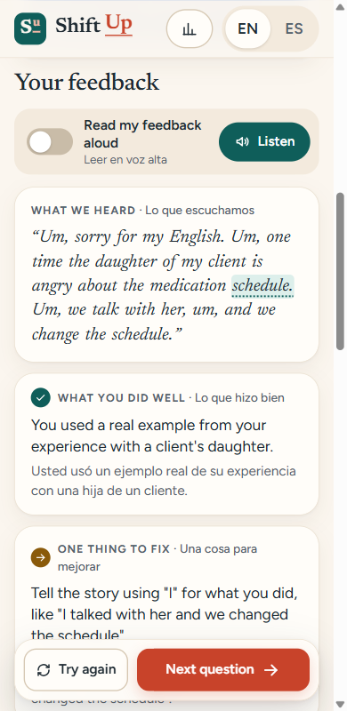

  

<h3 align="center">Practice the job interview in English. Get help in your language.</h3>

  An interview coach for Spanish-speaking workers going for hourly jobs, starting with home health aide. 
  Built at sunhacks 2026.

https://github.com/user-attachments/assets/8ca7dcd5-9518-4bda-8cae-a54cbec02daf

If the video does not play here, open <a href="docs/screenshots/ShiftUp.mp4">docs/screenshots/ShiftUp.mp4</a>.

  

## Why

Plenty of people already do the work and still lose the better job at the interview. Most of what goes wrong there is not their English. It is not knowing what a question is really asking, not saying "I did this" and how it ended, and not knowing what to do when they did not understand. Nerves make all of it worse.

Shift Up is a place to practise that out loud, as many times as it takes, with nobody watching. The interview is in English, like the real one. The help is in Spanish.

## What it does

### A real interview, out loud

An interviewer asks the question aloud, and her mouth follows the words. You answer out loud, and she listens.

- **Questions for this job.** Paste the job posting or your resume and she asks about what is in them: "This job asks for clear communication with families. Tell me about a time…"
- **She listens.** If your answer left something out, she asks about it, using your own words.
- **Go at your speed.** Captions in English or Spanish, a slower voice, and a repeat button.
- **It remembers you.** The next session starts with what was hard last time.

### Help in Spanish, without leaving the interview

  

- **What are they asking?** One line under each question says what the interviewer wants to hear. Nobody tells you this in a real interview.
- **Ask her to say it again.** When people do not understand, they tend to nod. Here you practise asking. Say "Could you say that again more slowly?" and she repeats the question slowly. It is never counted against you.
- **A coach on the side.** Ask anything in Spanish, typed or spoken. The coach answers in Spanish, out loud, with an English phrase you can tap to hear.

  

### Feedback on what you said and how you said it

Here the learner waited six seconds before starting, apologised for his English, said "um" four times, told the story in the present tense, and said "we" for what he did himself.

  

- **In both languages.** Every piece of feedback is in Spanish and English together. You choose which one leads.
- **One thing done well and one thing to fix.** The fix is about how interviews work, not grammar: say "I" for what you did, and say how it ended.
- **How you said it.** The wait before you started, long pauses and filler sounds are measured from the recording and named kindly, with one thing to practise next.
- **A stronger answer in your own words.** It is built only from what you said, the stories it remembers and your resume. Where it does not know a fact, it leaves a blank for you to fill in. It does not make up your story.
- **A plain warning when an answer would hurt you.** An honest answer can still cost you the job, and it says so.

  

### No accent score, anywhere

You get feedback on being clear, sounding sure and sounding natural. There is no pronunciation score, and nothing compares you with a native speaker. If the speech software misses a word, the feedback says the software missed it.

Help with pronunciation is there when you want it. Point at any English word to see how it sounds, written the way a Spanish speaker would read it, and to hear it at normal speed or slowly.

  

### Progress against yourself only

  

There is no leaderboard and no grade. Each session is set beside your own earlier ones.

### Made for a phone

  
  &nbsp;
  
  &nbsp;
  

## What happens in one turn

1. The interviewer speaks the question. Her mouth is drawn in the browser and timed to the speech, so there is no video.
2. You answer out loud. The recording is turned into words with the time of each one.
3. Our own code measures how long you waited, your pauses and your filler sounds. A second listener notes how you sounded.
4. A language model writes the feedback in both languages, under rules that forbid commenting on accent or inventing facts about you.
5. Your stories and what was hard are remembered for next time.

## What we were careful about

- **Your accent is never judged.** The aim is being understood, not sounding like someone else.
- **Nothing is invented about you.** A stronger answer may only use what you said, your remembered stories or your resume.
- **Your resume is read and not stored.** Recordings are not kept either.
- **The interviewer never asks what a real one may not:** age, origin, immigration status, religion, family plans or health.
- **It keeps working when a service does not.** If the microphone fails you can type, and if a question cannot be written the planned one is asked.

## Why we built it this way

- Studies of interviews for low-paid work in Britain found that migrant candidates did much worse, and traced it to the unstated expectations of "tell me about a time" questions. [Roberts, linguistic inequalities in the job interview](https://newdiversities.mmg.mpg.de/?p=1997)
- A review of 22 studies found that speakers with an accent were rated less hirable at the same level of competence. That bias belongs to the listener, so we do not train accent. [FU Berlin, 2024](https://fu-berlin.de/en/presse/informationen/fup/2024/fup_24_084-metastudie-dialekte-akzente-bewerbungsverfahren/index.html)
- In the United States an employer may not decide on a foreign accent unless it seriously interferes with the job. The test is being understood. [EEOC, in Spanish](https://www.eeoc.gov/es/laws/guidance/hoja-informativa-discriminacion-por-nacionalidad)
- Guides for immigrants tell job seekers to ask the interviewer to repeat a question they did not understand, but give no way to practise it. [USAHello, in Spanish](https://usahello.org/es/trabajo/encontrar-trabajo/entrevista-trabajo/)

## Where it stands

- It covers one job so far, home health aide, with ten questions written for it.
- It has not been tested with real learners yet. Jaciel, the learner in the screenshots, is a demo persona. His answers in the feedback screenshots were generated speech sent through the real app.
- The limits for a late start, pauses and fillers are our own judgment.

## More

- [`DEMO_SCRIPT.md`](DEMO_SCRIPT.md): the live demo, step by step.
- [`TEAM_BRIEF.md`](TEAM_BRIEF.md): the idea, who it is for and who would pay.
- [`ARCHITECTURE.md`](ARCHITECTURE.md): how it is put together.
- [`DESIGN_BRIEF.md`](DESIGN_BRIEF.md): the look and the reasons for it.

## Credits

Built during sunhacks 2026. We used Claude Code (Anthropic's Claude) to help plan, write and review the code and documents in this repository. Services used: Amazon Polly, Amazon Transcribe, the xAI Grok API (with Claude as the alternative), the Gemini API, and Supermemory.

The highlight video is a Hyperframes composition. Its music is by Sascha Ende (ende.app), used under CC BY 4.0.
